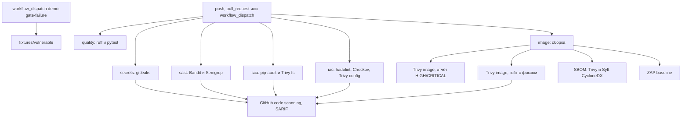

# DevSecOps pipeline demo

[](https://github.com/aidarshakirovr/devsecops-pipeline-demo/actions/workflows/ci.yml)

Учебный пайплайн для перехода из sysadmin/DevOps в ИБ: маленький HTTP-сервис и набор security-гейтов, которые на чистом коде проходят, а учебные находки показывают отдельным прогоном.

Сервис — FastAPI в памяти (`GET /health`, `GET /`, CRUD `/items`). В образ копируются только `requirements.txt` и `app/`. Учебные секреты и уязвимая зависимость лежат в `fixtures/vulnerable` и в образ не попадают.

Локальные команды ниже выполнены 24 ноября 2026 на Linux x86_64. Цифры взяты из этих прогонов.

## Схема



Основной workflow — `.github/workflows/ci.yml`. Он запускается на `push` в `main`, на `pull_request` и вручную. Учебный провал гейтов — `.github/workflows/demo-gate-failure.yml`, только `workflow_dispatch`, чтобы красный демонстрационный прогон не висел на каждом PR.

## Политика

Падать на **High** и **Critical**. Секреты — отдельное правило: любая находка gitleaks валит сборку, шкалы CVSS у утечки нет.

Исключения живут в [`security/exceptions.yml`](security/exceptions.yml). У каждой записи есть id, инструмент, предмет, причина, владелец и дата `expires`. `tests/test_exceptions.py` не даёт закоммитить пустую причину или просроченную дату.

| ID | Инструмент | Зачем |
| --- | --- | --- |
| EX-001 | gitleaks | `fixtures/vulnerable/**` исключён из основного гейта. Тот же каталог без allowlist сканирует `make demo-fail`. |
| EX-002 | trivy image | `--ignore-unfixed`: падать только на HIGH/CRITICAL, для которых есть исправленная версия. Неисправленные CVE базового образа в ignore по id не заносятся. |

Как порог выражен в каждом инструменте:

| Гейт | Команда | Когда падает |
| --- | --- | --- |
| secrets | gitleaks 8.30.1 | любая утечка |
| SAST | bandit 1.9.4 `-lll` | severity high |
| SAST | semgrep 1.186.0 `p/python --severity ERROR --error` | blocking finding |
| SCA | pip-audit 2.10.1 | любая известная уязвимость в `requirements.txt` |
| SCA | trivy 0.76.2 `fs --severity HIGH,CRITICAL` | high или critical |
| IaC | hadolint 2.15.1 `--failure-threshold error` | уровень error |
| IaC | checkov 3.4.10 | любой failed check Dockerfile или GitHub Actions |
| IaC | trivy `config --severity HIGH,CRITICAL` | high или critical |
| image | trivy `image --ignore-unfixed` | high или critical с фиксом |
| DAST | ZAP baseline 2.17.0 с `-I` | alert уровня FAIL. WARN сборку не валит |

## Что ловит каждый гейт

- **gitleaks** — секреты в истории git. В фикстуре это строка в `fixtures/vulnerable/config.env`, правило `generic-api-key`.
- **Bandit** — опасные вызовы Python. Фикстура `fixtures/vulnerable/app.py` вызывает `subprocess.run(..., shell=True)`: B602, high/high, CWE-78.
- **Semgrep** — тот же вызов, правило `python.lang.security.audit.subprocess-shell-true.subprocess-shell-true`, severity blocking. Набор правил `p/python` скачивается в момент запуска, метрики выключены (`SEMGREP_SEND_METRICS=off`).
- **pip-audit** и **Trivy fs** — зависимости из lock-файла `requirements.txt`, который собран `pip-compile` из `requirements.in`. В фикстуре закреплён `PyYAML==5.3.1`.
- **hadolint, Checkov, Trivy config** — Dockerfile боевого образа и, для Checkov, сами workflow. Учебный Dockerfile: `python:latest`, `MAINTAINER`, `USER root`, `sudo`, `ADD`, `EXPOSE 22`.
- **Trivy image** — CVE в собранном образе. SBOM пишут Trivy и Syft в CycloneDX JSON, это артефакт, не отдельный fail-гейт.
- **ZAP baseline** — пассивное сканирование поднятого контейнера. Образ сканера закреплён по digest `sha256:9624669…` (тег 2.17.0).

## Безопасность самого CI

- Сторонние actions закреплены полным SHA: `actions/checkout` v7.0.1, `actions/setup-python` v7.1.0, `actions/upload-artifact` v7.0.2, `github/codeql-action/upload-sarif` v4.39.5. Это проверяет `tests/test_pipeline.py`.
- Бинарники gitleaks, Trivy, hadolint и Syft ставятся `scripts/install-scanners.sh` с проверкой sha256.
- В корне workflow стоит `permissions: contents: read`. `security-events: write` есть только у jobs, которые грузят SARIF.
- `pull_request_target` нет. Секретов репозитория workflow не читает и в логи не пишет.
- `actions/checkout` вызывается с `persist-credentials: false`.
- gitleaks запускается с `--redact`. В логе `make demo-fail` значения фикстурного секрета нет: проверка `grep` по логу от 24 ноября секрета не нашла.
- Образ никуда не пушится, подписи cosign нет. Keyless-подпись требует push в registry и `id-token: write`; для этого MVP шаг не добавлялся.
- Bandit 1.9.4 не умеет SARIF (`-f` принимает csv, json, txt, xml, yaml и другие, но не sarif). В code scanning уходит SARIF Semgrep. Bandit остаётся гейтом по exit code.

## Локальный запуск

Нужны Python 3.12, Docker и `make`. Скрипт сканеров рассчитан на Linux amd64.

```bash
make install-dev
make install-scanners
make verify          # lint, pytest и гейты без Docker
make image           # сборка, Trivy, SBOM, ZAP
make demo-fail       # учебные находки; код 0 значит, что каждый гейт сработал
```

Отдельные цели: `make lint`, `make test`, `make secrets`, `make sast`, `make sca`, `make iac`, `make image-build`, `make image-report`, `make image-scan`, `make sbom`, `make dast`.

`make demo-fail` завершается нулём, когда все восемь проверок фикстуры завершились ненулевым кодом и в выводе есть ожидаемый маркер. Если фикстура перестала ловиться, цель падает.

Учебный workflow в GitHub: Actions → **demo-gate-failure** → Run workflow. Он ставит те же сканеры и вызывает `make demo-fail`.

## Прогон чистого кода

`make verify` 24 ноября 2026 завершился с кодом 0.

- ruff: `All checks passed`, format check без правок.
- pytest: 11 passed. Один warning зависимости: Starlette просит пакет `httpx2` вместо `httpx` в `TestClient`. На результат тестов это не повлияло.
- gitleaks по уже существующей истории git (на тот момент один коммит, README): `no leaks found`. Отдельно `gitleaks detect --no-git --source fixtures/vulnerable --config .gitleaks.toml` тоже сообщил `no leaks found`: allowlist EX-001 выкидывает этот путь целиком.
- Bandit по `app`, 61 строка: `No issues identified`, high = 0. Тот же каталог с `-ll` (medium и выше) тоже был пуст.
- Semgrep `p/python`: 55 правил, 2 файла, 0 findings.
- pip-audit по `requirements.txt`: `No known vulnerabilities found`. Тот же прогон по `requirements-dev.txt` тоже пустой.
- Trivy fs по `requirements.txt`: 0 уязвимостей.
- hadolint боевого Dockerfile с `--failure-threshold info`: без замечаний, exit 0. Порог гейта при этом `error`.
- Checkov Dockerfile: 48 passed, 0 failed. Checkov `github_actions` по `.github`: 184 passed, 0 failed.
- Trivy config по репозиторию с пропуском `fixtures` и виртуальных окружений: 0 misconfigurations уровня high/critical. Trivy 0.76.2 при этом не увидел YAML workflow как поддерживаемые файлы (`Detected config files: 1`, только Dockerfile). Actions закрывает Checkov.

Образ `devsecops-demo:local` собран из `python:3.12-slim-bookworm`, digest `sha256:44cf1793efa7c7a476bb0f2cff81443f4a072c90c1cb127e2924933daa3e8c64`.

Trivy image, уникальные пары CVE и пакета, severity high/critical:

- всего 101;
- high 99, critical 2;
- с фиксом 0, без фикса 101;
- статусы: `affected` 93, `fix_deferred` 7, `will_not_fix` 1.

Два critical: `CVE-2025-7458` в `libsqlite3-0` (`affected`, фикса нет) и `CVE-2023-45853` в `zlib1g` (`will_not_fix`). Гейт `trivy image --ignore-unfixed --exit-code 1` завершился с кодом 0.

SBOM CycloneDX 1.7:

- Trivy: 121 компонент, `build/sbom-trivy.cdx.json`;
- Syft 1.57.2 без file cataloger: 128 компонентов (library 120, application 7, operating-system 1).

ZAP baseline против контейнера, цель `http://127.0.0.1:8000`, флаг `-I`:

```text
FAIL-NEW: 0  FAIL-INPROG: 0  WARN-NEW: 2  WARN-INPROG: 0  INFO: 0  IGNORE: 0  PASS: 66
```

Код выхода 0. Два предупреждения, которые гейт не валит:

- `Non-Storable Content` [10049];
- `Cross-Origin-Resource-Policy Header Missing or Invalid` [90004].

Сканер сидит в сетевом пространстве контейнера приложения (`--network container:`), потому что в этой среде маршрутизация между двумя bridge-контейнерами давала timeout, хотя проброшенный на localhost порт отвечал.

## Пример срабатывания

`make demo-fail` 24 ноября 2026 закончился строкой `demo-fail: every gate caught the vulnerable fixture`, код 0. Каждый гейт при этом сам завершился с ненулевым кодом.

gitleaks, секрет в логе за redact:

```text
9:33PM WRN leaks found: 1
CAUGHT: gitleaks (exit 1)
```

Отдельный JSON-отчёт того же файла назвал правило `generic-api-key` и строку 2 в `fixtures/vulnerable/config.env`.

Bandit:

```text
>> Issue: [B602:subprocess_popen_with_shell_equals_true] subprocess call with shell=True identified, security issue.
   Severity: High   Confidence: High
CAUGHT: bandit (exit 1)
```

Semgrep: 1 blocking finding, правило `subprocess-shell-true`, exit 1.

pip-audit напечатал `PYSEC-2021-142` для `pyyaml 5.3.1`, fix `5.4`, и вывел одну и ту же запись дважды. Exit 1.

Trivy fs:

```text
Total: 1 (HIGH: 0, CRITICAL: 1)
PyYAML  CVE-2020-14343  CRITICAL  fixed  5.3.1  5.4
CAUGHT: trivy-fs (exit 1)
```

hadolint, среди прочего ошибки `DL4000` (`MAINTAINER`), `DL3004` (`sudo`) и `DL3020` (`ADD`). Exit 1.

Checkov: `Passed checks: 20, Failed checks: 7`. В списке есть `CKV_DOCKER_8` (последний `USER` — root) и `CKV_DOCKER_1` (порт 22). Exit 1.

Trivy config: `Failures: 5 (HIGH: 3, CRITICAL: 2)`, в том числе `DS-0010` critical на `sudo`. Exit 1.

## Ограничения

- Cosign keyless не подключён: нет push образа и нет `id-token: write`.
- Bandit не отдаёт SARIF в версии 1.9.4, поэтому в code scanning попадает Semgrep.
- Загрузка SARIF в code scanning на PR может не сработать, пока workflow ещё не лежит в `main`. Шаг загрузки помечен `continue-on-error`, сам гейт от этого не зависит. Итог смотреть в логе job на GitHub.
- У базового Debian-образа 101 high/critical без фикса. Гейт их не валит из-за EX-002. Табличный отчёт `make image-report` их показывает.
- ZAP с `-I` не валит сборку на двух WARN выше. High не было.
- Trivy config не разбирает GitHub Actions workflow. Их смотрит Checkov и тест на SHA и права.
- Правила Semgrep `p/python` приезжают из registry во время скана, состав может сдвинуться.
- `pip-audit` строже политики high/critical: падает на любой известной уязвимости. Сейчас в lock-файле их нет.
- Скрипт установки сканеров собран под Linux amd64.
- Учебный секрет — фиктивная строка под правило gitleaks, не боевой ключ. В README значение не повторяется.
